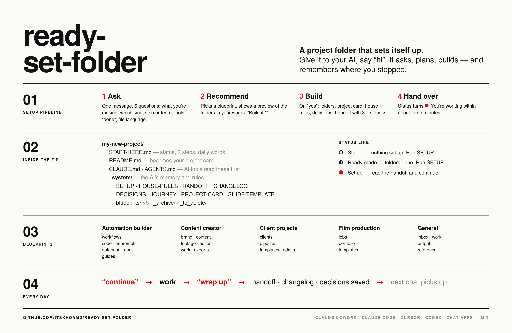

# ready-set-folder

**A project folder that sets itself up.** Download it, give it to your AI (Claude Cowork, Claude Code, Cursor…), say **"hi"**. The AI asks you a few questions, shows you the folder setup that fits your kind of project, and builds it. Rules and memory included, so your AI never forgets where you stopped.

> Built by a non-coder, for people who build with AI. Every setup comes from a real project I run.

## ⬇ Get started (3 minutes)
1. **[Download ready-set-folder.zip](https://github.com/itskhoamd/ready-set-folder/releases/latest/download/ready-set-folder.zip)** and unzip it. Rename the folder to your project if you like.
2. **Give the folder to your AI:**
   - **Claude Cowork:** Projects → **+** → **Use an existing folder** → pick it. In **Instructions**, paste: `Read START-HERE.md in this folder and follow it.`
   - **Claude Code · Cursor · Codex:** open the folder.
3. **Say "hi".** Answer ~6 quick questions → see the plan → say **yes** → done.

From then on, say **"continue"** when you start a session and **"wrap up"** when you finish. That's it.

## What the AI asks, and what you get
It asks what you're working on, which kind of project it is, solo or team, your tools, what "done" looks like, and which language your files should be in. Then it picks one of these setups, shows you a preview, and builds it on your yes:

| Setup | For | Folders it makes |
|---|---|---|
| 🤖 **automation-builder** | n8n / Make / Zapier automations, AI agents, bots | `workflows/` · `code/` · `ai-prompts/` · `database/` · `docs/` · `guides/` |
| 🎬 **content-creator** | Reels, videos, podcasts | `brand/` · `content/` · `footage/` · `editor/` · `work/` · `exports/` |
| 💼 **client-projects** | Freelancers and small agencies | `clients/` · `pipeline/` · `templates/` · `admin/` |
| 🎥 **film-production** | PAs, coordinators, producers on shoots | `jobs/` · `portfolio/` · `templates/` |
| 🗂️ **general** | Anything else, or a mix | `inbox/` · `work/` · `output/` · `reference/` |

Every folder has a one-line `README.md` saying what goes in it, so you and the AI always know where things belong. The AI's memory (handoff, changelog, decisions) and house rules (never delete, never store your keys, ask before anything risky) live in `_system/`, out of your way.

## In this repo
| | |
|---|---|
| **[1-start-here/](1-start-here/)** | The starter: what's inside `ready-set-folder.zip`. **This is all most people need.** |
| **[2-ready-made/](2-ready-made/)** | The same setups with the folders already made. For chat apps (claude.ai, ChatGPT, Gemini) that can't create folders, or if you already know what you want. |
| **[3-see-an-example/](3-see-an-example/)** | A fictional project a few days in, to see it in use. |
| `_system/` | How it's built. Only for contributors. |

Want a setup for your kind of work? **[Request it in Discussions](https://github.com/itskhoamd/ready-set-folder/discussions)**: new setups get built from real requests.

## FAQ
**Does it work with ChatGPT / Gemini / claude.ai chats?** Yes, with one extra step: chat apps can't create folders, so download a **[ready-made](2-ready-made/)** workspace, attach `START-HERE.md` and `_system/SETUP.md`, and say "hi". The AI does the rest and gives you the text to paste.

**Does it cost a lot of tokens?** The setup reads two short files. A normal session reads about 3,000 tokens of notes, far less than re-explaining your project every time.

**Can I change the folders later?** Yes. Say "redo setup", or just add a folder with a `README.md`. Say "tidy up" when things get messy.

**Does it work with Obsidian / Google Drive?** It's plain folders and Markdown files, so it works anywhere files work.

**Is my data safe?** The download contains no data, only structure and rules. The rules tell the AI to keep keys out of files and ask before anything that can't be undone; the `.gitignore` keeps client and crew data out of Git. Still: keep any repo with real data **private**.

## Contributing
See [`_system/README.md`](_system/README.md).

## Licence
[MIT](LICENSE): free to use, change and share, including for paid work.

---
Made by **Khoa** ([@itskhoa.md](https://www.instagram.com/itskhoa.md/)), a beatboxer learning AI tech in public. If this saved you a chat or two, a ⭐ helps others find it.
